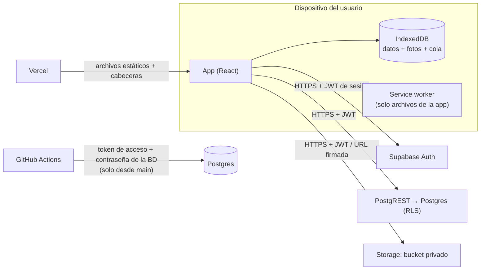

# Modelo de amenazas

Qué protege Guardarropa, de quién, dónde están los límites de confianza y qué controles lo sostienen. Complementa a [`DISENO.md`](DISENO.md) y a [`SECURITY.md`](../SECURITY.md). Revísalo cuando agregues una tabla, una integración o un flujo de autenticación.

## Sistema

PWA estática (React + Vite) servida por Vercel. No hay servidor propio: el navegador habla directo con Supabase (Auth, PostgREST y Storage) usando la clave **pública**. La seguridad de los datos descansa en Postgres: **Row Level Security** y claves foráneas compuestas.

## Activos

| Activo | Dónde vive | Por qué importa |
|---|---|---|
| Fotos de prendas y fotos del usuario usando outfits | Storage (bucket privado) y caché en IndexedDB | Datos personales; pueden mostrar la cara, el cuerpo o la casa del usuario |
| Inventario, historial de uso, perfumes, notas | Postgres y copia en IndexedDB | Hábitos y rutinas del usuario |
| Credenciales del usuario y sesión | Supabase Auth; token de sesión en `localStorage` | Dan acceso a todo lo anterior |
| Token de acceso de Supabase y contraseña de la BD | GitHub Secrets | Control total del proyecto, sin RLS |
| Clave `service_role` / `secret` | Solo en el panel de Supabase | Salta RLS; nunca debe salir de ahí |
| Respaldos `.zip` | Donde el usuario los guarde | Contienen todos los datos y fotos |

## Actores

- **Usuario con sesión:** dueño de sus datos. Puede llamar directo a la API con su JWT, saltándose la interfaz.
- **Otro usuario con sesión en el mismo proyecto:** no debe ver ni modificar nada ajeno, aunque conozca los id.
- **Anónimo en internet:** conoce la URL de la app, la URL del proyecto y la clave pública (van en el JavaScript servido).
- **Contribuidor externo:** abre pull requests, posiblemente desde un fork.
- **Quien tiene el dispositivo:** acceso físico a un teléfono o computadora con la app instalada.
- **Cadena de suministro:** dependencias de npm, actions de GitHub, CLI de Supabase.

## Límites de confianza

1. **Navegador ↔ Supabase.** Todo lo que llega del cliente es no confiable. Postgres decide con RLS, `CHECK` y claves foráneas; la interfaz no es un control de acceso.
2. **Archivos externos ↔ app.** Los respaldos `.zip`, CSV y JSON de los scripts vienen de fuera: se validan antes de usarse.
3. **Pull requests ↔ secretos.** El código de un PR no debe llegar a los secretos de producción.
4. **Dispositivo ↔ nube.** La copia local queda en el dispositivo; su protección depende del bloqueo del sistema operativo.

## Amenazas y controles

| # | Amenaza | Control | Cómo se verifica |
|---|---|---|---|
| T1 | Un usuario lee o modifica datos de otro conociendo sus id (IDOR) | RLS "solo el dueño" en todas las tablas; políticas en `storage.objects` por carpeta `<user_id>/`; `WITH CHECK` impide cambiar `user_id` | `npm run test:rls` (70 comprobaciones) en CI |
| T2 | Una fila propia apunta a datos de otro usuario | Claves foráneas compuestas `(user_id, id)`; `photo_path` debe empezar con la carpeta del dueño | `npm run test:rls` |
| T3 | Alguien sin sesión lee o escribe | `revoke all ... from anon` en cada tabla; la función de catálogo no es ejecutable por `anon` | `npm run test:rls` |
| T4 | Registro de cuentas no autorizado | Registro desactivado en Supabase Auth; la app no tiene pantalla de registro | Configuración del panel (paso 2.2 del README) |
| T5 | La clave secreta llega al navegador | La app y los scripts detectan `sb_secret_` y JWT `service_role` y se niegan a seguir; CI busca claves y JWT en el código | Pruebas unitarias + CI |
| T6 | XSS que roba la sesión | React escapa todo el texto; no hay HTML dinámico; CSP sin `unsafe-inline` ni `eval`, `script-src 'self'`; `frame-ancestors 'none'` | Prueba de cabeceras + recorrido en navegador sin violaciones |
| T7 | Respaldo manipulado | Rutas de fotos con forma fija; contenido verificado como JPEG/WebP por sus bytes; ids reasignados al restaurar; RLS en el servidor | Pruebas unitarias de respaldo |
| T8 | Fotos ajenas o archivos peligrosos en Storage | Bucket privado, URL firmadas de 1 h, máx. 5 MB, solo JPEG/WebP; las fotos agregadas en la app se recomprimen en el dispositivo (sin metadatos EXIF); las de un respaldo se validan por su contenido | `npm run test:rls` (bucket) + pruebas de respaldo |
| T9 | Un PR o un fork obtiene los secretos | La CI no usa secretos; las migraciones solo corren en `main` (push o ejecución manual) con secretos por paso | Revisión de workflows |
| T10 | Dependencia, action o CLI comprometida | Lockfile, actions fijadas por SHA, CLI de Supabase con versión exacta, `npm audit` de producción en CI, Dependabot | CI |
| T11 | Fuerza bruta contra el inicio de sesión | Límites de Supabase Auth por IP; contraseña larga (README) | Configuración de Supabase |
| T12 | Dispositivo compartido | Al cerrar sesión se borran la base local, la caché de fotos y las preferencias de la cuenta | Revisión de código |

## Riesgos aceptados

- **Copia local sin cifrar.** IndexedDB guarda datos y fotos para funcionar sin conexión. Quien desbloquee el dispositivo puede verlos. Mitigación: bloqueo del sistema operativo y cerrar sesión en equipos compartidos.
- **Sesión revocada en un dispositivo sin conexión.** Si se revoca una sesión desde el servidor, el dispositivo deja de sincronizar, pero la copia local sigue ahí hasta cerrar sesión, para no perder cambios sin enviar.
- **Token de sesión en `localStorage`.** Es el comportamiento estándar de Supabase en una SPA; un XSS podría leerlo. La CSP y la ausencia de HTML dinámico reducen ese riesgo.
- **Sin recuperación de contraseña por correo.** El cambio se hace desde el panel de Supabase (README, «Si olvidas tu contraseña»). Evita depender de la configuración de redirecciones.
- **Privilegios por defecto de Supabase.** El rol `authenticated` conserva `TRUNCATE`/`REFERENCES`/`TRIGGER` en las tablas de `public`. La API de datos no los expone; revocarlos es una mejora de defensa en profundidad pendiente.

## Fuera del alcance

La seguridad de Supabase, Vercel y GitHub como plataformas, y la del sistema operativo del dispositivo.
